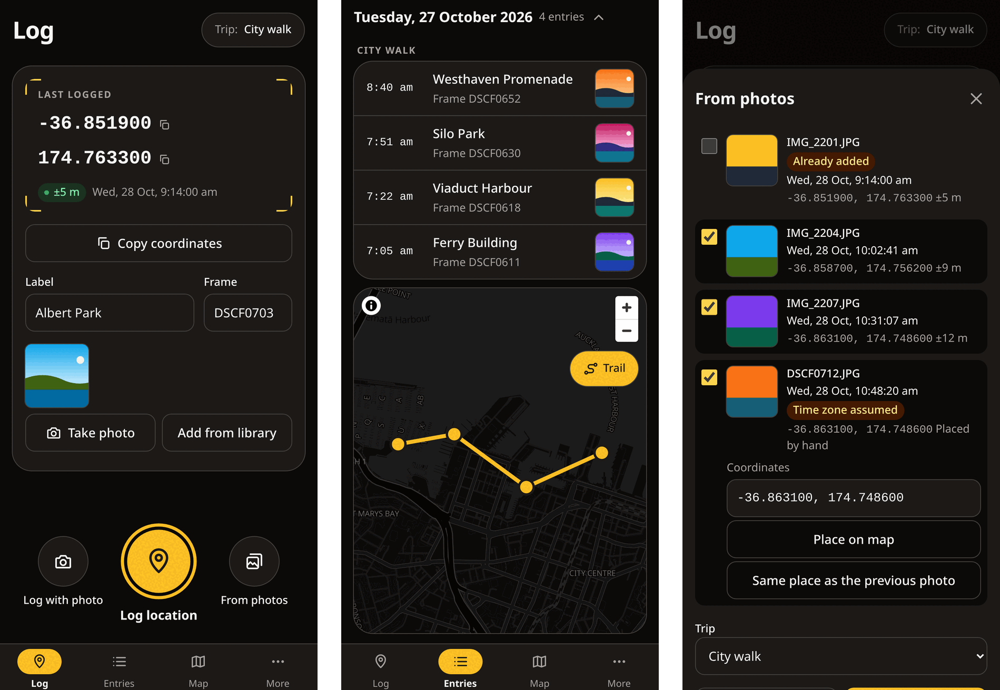

#  Hotshoe

Log where you took a photo, so you can geotag it later.

Hotshoe is a small web app for iPhone, installed to the Home Screen from Safari. Tap one button when you take a photo and it records your location, accuracy, and time. You can attach a quick reference photo from the iPhone camera, then copy the coordinates into any photo site or map app, or export a GPX track for digiKam, Lightroom, or darktable.

Your entries stay on your phone. There is no account, no server, and no tracking.

**Open it:** https://xe1af35.github.io/hotshoe/



## Install on iPhone

1. Open the link above in **Safari**.
2. Tap the Share button, then **Add to Home Screen**.
3. Open Hotshoe from the Home Screen, not from Safari. A Safari tab keeps its own separate entries.
4. The first time you log, allow location **While Using the App**. Keep **Precise Location** on, or fixes are only good to a few kilometres.

Hotshoe works offline after the first visit, and updates itself the next time you leave the app.

## Using it

- **Log:** tap **Log location** as you take a photo. Hotshoe waits until the fix is within your accuracy target (20 m unless you change it), then saves. **Use this fix** saves the best fix so far, marked as a weak fix if it missed the target. **Log with photo** also opens the camera for a reference shot.
- **Label and frame:** type them on the card after logging. Nothing blocks the next log.
- **Copy coordinates:** pastes as `-36.848461, 174.763336`, or as degrees, minutes, and seconds if you choose that in Settings. Choose a decimal comma in Settings for apps that want `-36,848461`, and tap either line of an entry's coordinates to copy just that number.
- **Trips:** pick an active trip on the Log screen and new entries join it. Open a trip on the More tab for its summary: entries and photos, the dates and days it covers, the rough distance in straight lines between entries, and how many weak fixes it has.
- **Entries:** grouped by day and trip. Tap one to edit it, add photos, or show it on the map. **Select** lets you tick entries and export just those.
- **Map:** asks before loading, because the map comes from an online service (see Privacy).
- **Light or dark:** Hotshoe follows your iPhone's setting. To keep it light or dark whatever the iPhone does, choose **Appearance** in Settings on the More tab.

## Geotagging your photos

1. On the More tab, choose **Export**, pick the entries and **GPX**, then save the file to Files or AirDrop it to your computer.
2. Load the GPX in your photo software's geotagging tool (Lightroom Classic's Map module, darktable's geotagging module, or digiKam's geolocation editor).
3. GPX times are in UTC. If your camera clock is set to local time, tell the software your camera's time zone or offset.

Each trip is its own track and each day its own segment, so the software doesn't guess positions between days. CSV (for spreadsheets) and GeoJSON (for maps and GIS apps) exports are there too.

### When the camera's clock is off

Camera clocks drift, and are easy to leave on the wrong time zone. To correct for both:

1. On the More tab, open a trip and tap **Show clock to photograph**, then take a photo of that clock with your camera.
2. When you have the photo to hand, tap **Enter times from the photo** and type the time on Hotshoe's clock in the photo and the camera's own time for it, both with seconds.
3. Export that trip as GPX with **Match this trip's camera clock** ticked, and choose the time zone you set in your photo software. It starts on your iPhone's time zone from when you measured the clock, which is what most people enter anyway.
4. Set the same time zone in your photo software when geotagging. The file also notes it, in its description.

## Back up

Hotshoe keeps everything on this iPhone only. Deleting the app deletes your entries, and photos taken in Hotshoe aren't in your Photos app.

- On the More tab, tap **Make backup**, then **Save or share backup**, and save it somewhere safe such as iCloud Drive. Keep **Include photos** ticked unless you only want a small text copy.
- Hotshoe reminds you on the Log screen when a backup is due. You choose how often in Settings.
- To restore, tap **Restore from a backup**. You see what's in the file first, then choose to add it to what's here or replace everything.

## Privacy

- Your entries and photos never leave the phone unless you export, share, or back them up yourself.
- **The map is the one exception.** To draw it, Hotshoe asks [OpenFreeMap](https://openfreemap.org/) for the area on screen, so OpenFreeMap sees that area and your internet address, but not your entries. Hotshoe asks before loading the map, unless you turn on loading it without asking.
- The app itself is served by GitHub Pages, which sees your internet address when the app is installed or updated.
- Photos are re-encoded on the phone, so camera metadata such as the photo's own location isn't kept.
- There are no analytics, cookies, or accounts.

Map data © [OpenStreetMap](https://www.openstreetmap.org/copyright) contributors.

## Development

Before a release, run through the [on-device checklist](docs/device-checklist.md).

Requirements: Node 22.12 or later (CI uses Node 24) and pnpm.

```sh
pnpm install
pnpm dev                # local dev server
pnpm check              # Biome lint and format check
pnpm typecheck          # TypeScript
pnpm test               # unit tests (Vitest)
pnpm build && pnpm size # production build and bundle size budget
pnpm test:e2e           # end-to-end tests in WebKit with an iPhone viewport
```

Playwright's WebKit build needs Ubuntu or Debian system libraries. On other Linux distributions, run `pnpm test:e2e:chromium` locally instead; CI always runs the WebKit suite.

### Build options

- `BASE_PATH`: the path the app is served from. Defaults to `/hotshoe/` for GitHub Pages. Use `/` for a custom domain.
- `PWA_SELF_DESTROY=true`: builds a service worker that removes itself and its caches. Deploy this only to recover from a broken release, then deploy a normal build.

Everything Hotshoe stores in the browser (the database, the caches, and the light or dark choice in local storage) is named with a `hotshoe` prefix, so it never clashes with other apps served from the same address.

### Icons

The app icons in `public/` are made from `public/app-icon.png`, a hand-drawn icon. After changing the drawing, run `pnpm dlx @vite-pwa/assets-generator@2.0.0` and commit the results.

## Licence

[MIT](LICENSE)
